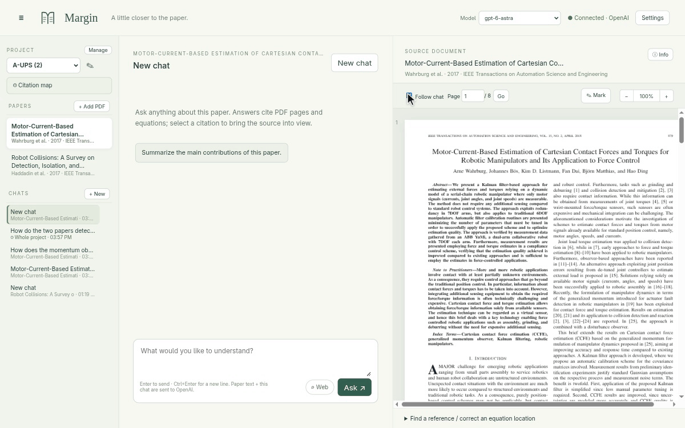
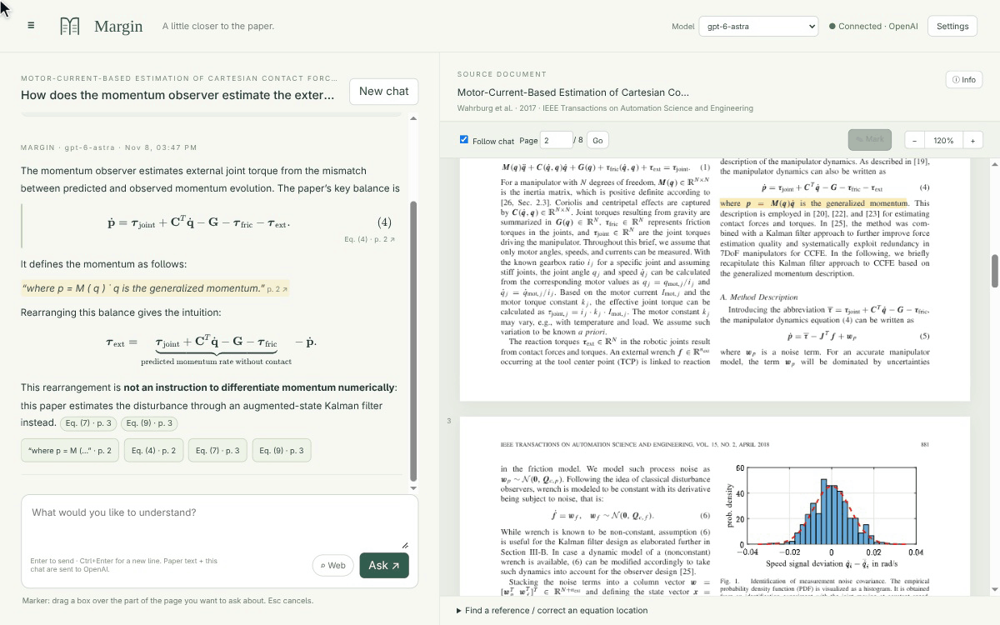
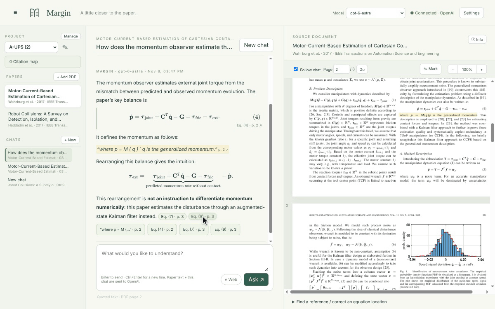
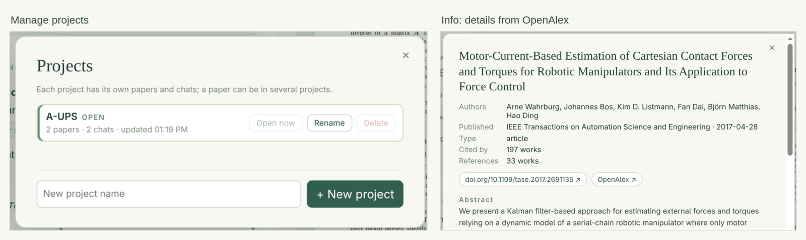
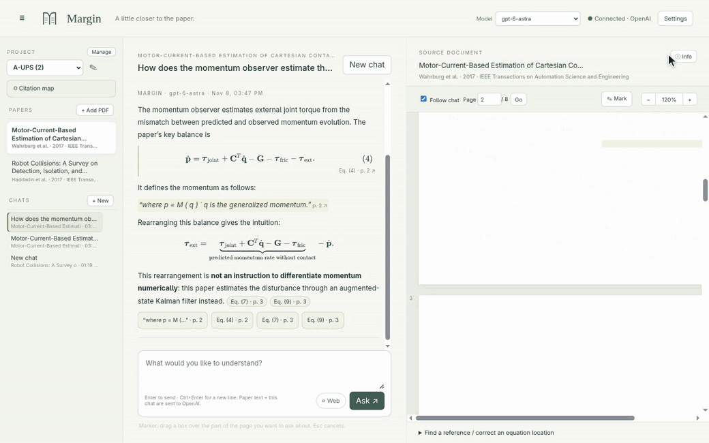
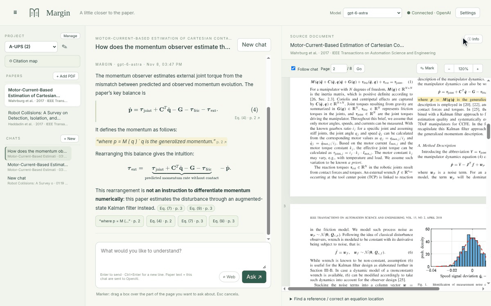
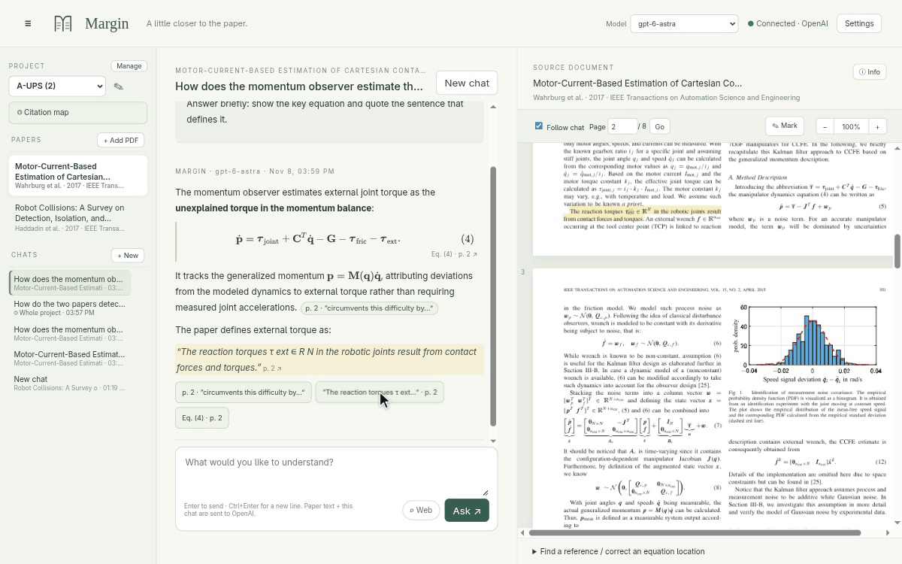

# Margin

**Read a research paper beside an AI tutor whose citations jump to the exact page and equation.**

Margin puts a chat on the left and the PDF on the right. Ask about a passage, an equation or a figure, and the answer points back into the paper: click a citation and Margin frames the equation or highlights the quoted words, so you can check every claim against the source. Keep papers in projects, see how they cite each other, and ask questions across a whole project. Margin runs on your computer with your own OpenAI or Claude API key.



## Download and install

Get the latest version from **[Releases](https://github.com/QuokeCola/margin/releases/latest)**:

| System | File | Notes |
|---|---|---|
| Linux | `Margin-<version>-linux-x86_64.AppImage` | `chmod +x Margin-*.AppImage`, then run it. |
| Debian / Ubuntu | `Margin-<version>-linux-amd64.deb` | `sudo apt install ./Margin-*.deb` |
| Windows | `Margin-<version>-win-x64.exe` | The app is not code-signed, so SmartScreen may warn: **More info → Run anyway**. |
| macOS (Apple silicon / Intel) | `Margin-<version>-mac-arm64.dmg` / `-mac-x64.dmg` | Not notarized. First launch: right-click the app → **Open**, or **System Settings → Privacy & Security → Open Anyway**. |

### Add your API key

Margin answers with **OpenAI** or **Claude**. You need an API key from one of them (answers are billed per use to your account).

**OpenAI**

1. Create a key at **[platform.openai.com/api-keys](https://platform.openai.com/api-keys)** (**Create new secret key**). Add credit under Billing if your account has none.
2. In Margin, open **Settings**, choose **OpenAI**, paste the key and click **Save**.

**Claude**

1. Create a key at **[platform.claude.com/settings/keys](https://platform.claude.com/settings/keys)** (**Create Key**). Add credits under Billing if needed.
2. In Margin, open **Settings**, choose **Claude**, paste the key and click **Save**.

Margin checks the key with the provider and keeps it only on your computer. You can save both keys and switch at any time; pick a model from the **Model** menu in the header.

## What you can do

### Read and ask

Select text, draw a box with **✎ Mark** around a figure or any part of a page, or click a numbered equation, then press **Ask AI ↗**. What you picked is attached to your question together with an image of it, so symbols that the PDF's text loses still reach the AI.



### Answers you can check

Answers cite pages, equations and the exact words they rely on. Click a citation: equations get a frame on the page, quotes are highlighted word for word. With **Follow chat** on, the PDF moves to the citations of the answer you are reading.



### Projects

Keep papers and chats in projects; a paper can be in several projects and is stored once. **Manage** lists, renames and creates projects. **ⓘ Info** shows a paper's details (authors, venue, citation counts, abstract) and its reference list.



Numbered citations in the PDF, such as “[19]”, are clickable: a card shows the cited paper with its abstract and **Add to project**.

![Clicking a [25] marker in the PDF opens a card with the cited paper's details, abstract and Add to project](docs/images/reference-card.gif)

### Citation map

**◎ Citation map** shows how a project's papers connect: your papers, the works they cite and the works citing them. Papers linked to more than one of yours are marked as shared. Filter to shared papers only, arrange everything by year, and click any paper for its details, **Add to project** or **Expand** (pull in its own references and citers).



### Chat with a whole project

Start a **New chat → Whole project** to ask across all papers in a project. Citations name the paper they come from, and clicking one opens that paper at the quoted words. Turn on **⌕ Web** to let an answer also search the web; the pages it used are listed under the answer.




### Getting papers

**+ Add PDF** (or drag a PDF onto the window) adds a file you have. For papers you find through references or the map, **Add to project** first tries a free open-access copy, then your own browser through the Margin connector, then a sign-in window inside the desktop app (through your library proxy if you set one in Settings). Paywalled papers still need your institution's access; Margin only uses logins you already have.

**Margin connector** is a small browser extension (Chrome, Edge, Brave) that fetches PDFs through the browser where you are already signed in:

- Open `chrome://extensions` and turn on **Developer mode**.
- Click **Load unpacked** and choose the folder shown in Margin's **Settings → Browser extension**.
- Click the Margin icon in the toolbar and paste the pairing code from Settings (**Show code** copies it).
- On any paper page you can also click the icon → **Send this page's PDF to Margin**.


### Choose your AI

Switch between **OpenAI** and **Claude** in Settings; each keeps its own key and model. Each step of the setup has a short guide drawing and links to the provider's key, usage and billing pages.


### Dark mode

Choose **System**, **Light** or **Dark** under **Settings → Theme**.



## Privacy

Margin has no account and no analytics. What leaves your computer:

- **To the AI provider you chose** (OpenAI or Anthropic), when you ask:
  - *This paper* chats: the paper's text, the recent messages of the chat, your question and any attached image.
  - *Whole project* chats: each paper's title, authors and abstract, the passages most relevant to your question, the recent messages and your question.
  - With **Web** on, the model may search the web.
- **To OpenAI for project search:** if an OpenAI key is saved, whole-project chats send the papers' text once (and your questions) to OpenAI's embeddings service to find relevant passages, also when Claude answers. Without an OpenAI key, Margin searches by keywords on your computer.
- **To OpenAlex** (Crossref as a fallback): DOIs and titles, to look up paper details, references and citing works.

Everything else stays on your computer: your papers, chats and projects, and your API keys, which are stored locally and sent only to their own provider.

**Tips**

- *Extension can't connect?* Make sure Margin is running, then open the extension's popup: it says whether it found Margin and is paired.
- *A Web answer fails?* The model may not support web search; turn **Web** off or pick another model.
- *Paywalled paper won't download?* You need your institution's access: sign in through the sign-in window, your library proxy or the connector.

## Build from source

Requires Node.js 22.12 or newer.

```bash
git clone https://github.com/QuokeCola/margin.git
cd margin
npm ci
npm run app      # desktop app; or `npm run dev` and open http://127.0.0.1:4317
```
