# Margin

**Read a research paper beside an AI tutor whose citations jump to the exact page and equation.**

Margin puts a chat on the left and the PDF on the right. Answers cite pages, equations and quoted sentences, and every citation is clickable: equations get a tight frame in the PDF, quotes are highlighted word for word. Select text, mark an area or click an equation to ask about it. Papers are grouped into projects with their references, a citation map and chats that can cover the whole project. It runs on your computer with your own OpenAI or Anthropic (Claude) API key.

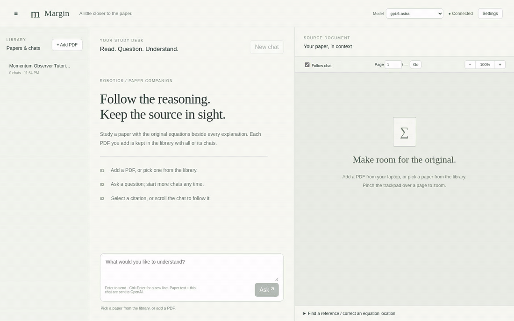

## Download

Get the latest build from **[Releases](https://github.com/QuokeCola/margin/releases/latest)**:

| System | File | Notes |
|---|---|---|
| Linux | `Margin-<version>-linux-x86_64.AppImage` | `chmod +x Margin-*.AppImage`, then run it. |
| Debian / Ubuntu | `Margin-<version>-linux-amd64.deb` | `sudo apt install ./Margin-*.deb` |
| Windows | `Margin-<version>-win-x64.exe` | Installer. The app is not code-signed, so SmartScreen may warn: **More info → Run anyway**. |
| macOS (Apple silicon / Intel) | `Margin-<version>-mac-arm64.dmg` / `-mac-x64.dmg` | Not notarized. First launch: right-click the app → **Open**, or **System Settings → Privacy & Security → Open Anyway**. |

### Set up your API key

Margin works with **OpenAI** or **Claude** (Anthropic); pick one under **Settings → AI provider**. You can save both keys and switch any time.

**OpenAI**


1. Create a key at **[platform.openai.com/api-keys](https://platform.openai.com/api-keys)** (**Create new secret key**). Add credit under [Billing](https://platform.openai.com/settings/organization/billing/overview) if your account has none; answers are billed per use.
2. In Margin, click **Settings**, paste the key and click **Save**. It is checked with OpenAI and stored only on your computer (desktop app: `~/.config/Margin`, `%APPDATA%\Margin` or `~/Library/Application Support/Margin`).
3. Pick a model from the **Model** menu in the header.

**Claude**

1. Sign in at **[platform.claude.com](https://platform.claude.com/settings/keys)** (the Claude Console), open **Settings → API keys** and click **Create Key**. Add credits under [Billing](https://platform.claude.com/settings/billing) if needed; answers are billed per use.
2. In Margin, open **Settings**, choose **Claude**, paste the key into **Anthropic API key** and click **Save**. It is checked with Anthropic and stored only on your computer.
3. Pick a Claude model from the **Model** menu (default `claude-opus-5-5`).

Whole-project chats find passages with OpenAI embeddings. With only a Claude key they use keyword search instead; add an OpenAI key as well for semantic search (embeddings are billed to OpenAI).

## What it does

### Read and ask

- **PDF viewer** with pinch-to-zoom on the trackpad (or Ctrl + scroll), zooming around the cursor; also − / % / +. Range 50–300%, remembered.
- **Equation detection.** Numbered equations get a dashed frame on hover; click one, then **Ask AI about Eq. (n) ↗** to attach a cropped image of it.
- **Select text** on a page → **Ask AI about this ↗** attaches the passage plus an image of the selected lines.
- **✎ Mark** an area (text, equation, figure) → **Ask AI about this area ↗** attaches a sharp image, the text inside it and its page and position.
- **Anchored citations.** Answers cite the exact supporting words (`p. 6 · “wrenches orthogonal to the…”`); clicking highlights them in the PDF. Equation chips (`Eq. (46) · p. 7`) frame the equation, page links outline the page, and equations reproduced from the paper link back to their source.
- **Follow chat** moves the PDF to the first citation of the answer you scroll to.

| Equations in answers link to a frame in the PDF | Quotes are highlighted word for word |
|---|---|
| 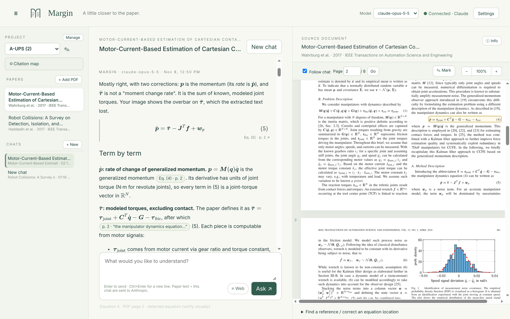 | 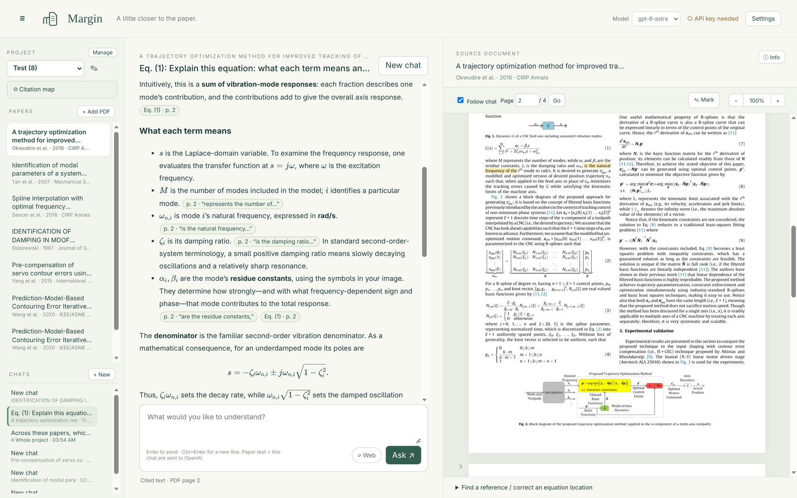 |
| **Click an equation in the PDF to ask about it** | **The equation is attached as an image** |
| 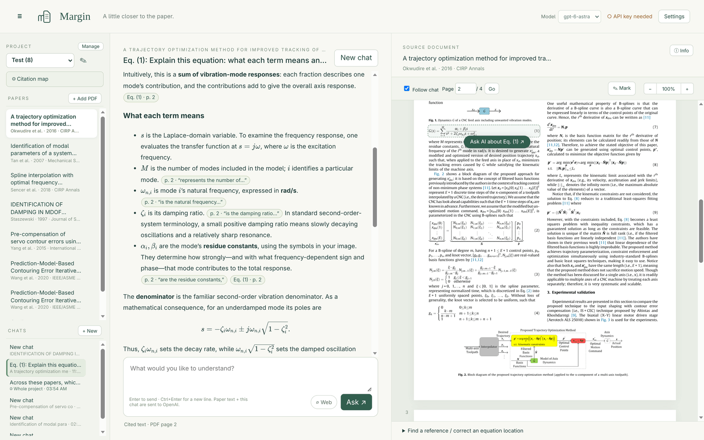 | 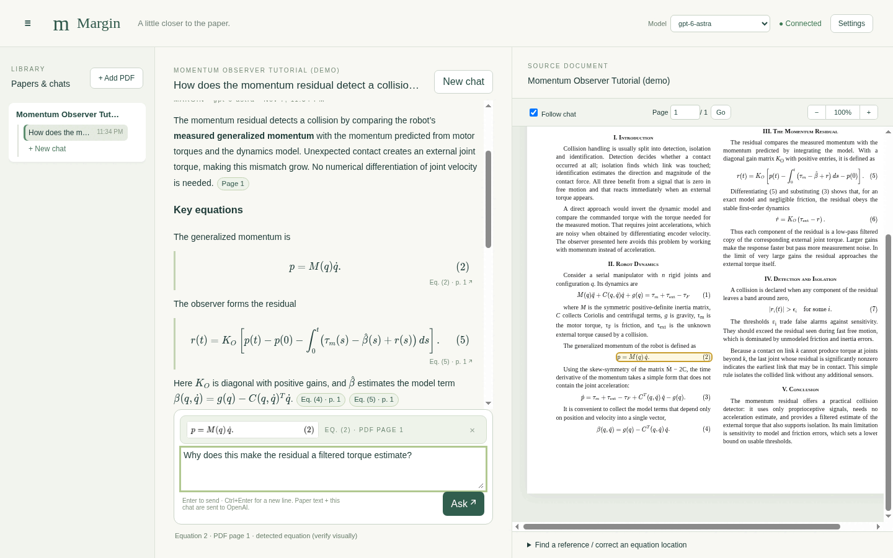 |

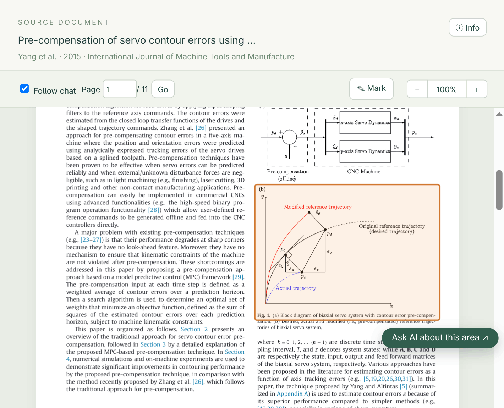

### Projects, papers and references

- **Projects → papers → chats.** A project holds papers and chats. A paper can be in several projects and is stored once.
- **Paper details** (title, authors, venue, date, DOI, abstract, citation counts) come from OpenAlex, with Crossref as a fallback. **ⓘ Info** shows them and lets you fix the DOI.
- **Clickable references.** Numbered citations in the PDF (“[12]”, “[3, 7]”, “[21]–[23]”) open a card with the cited paper's details and abstract, plus **Open in Margin** or **Add to project**. **ⓘ Info** lists all references with the same actions.

![Reference card opened from a [1] marker in the PDF, with the cited paper's title, authors, abstract and Add to project](docs/images/reference-card.png)

### Citation map

**◎ Citation map** in the sidebar shows how the project's papers relate:

- your papers (green), the works they cite (amber) and the most-cited works citing them (blue);
- papers linked to two or more of yours are marked as shared; **Only shared** hides the rest;
- **Arrange by year** turns it into a timeline;
- click a paper for **Open in Margin**, **Add to project** or **Expand** (pull in its own references and citers).

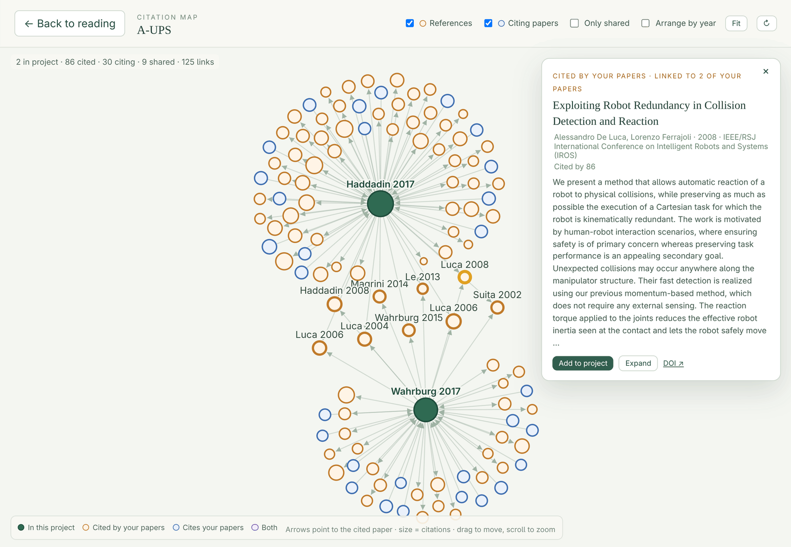

### Chats about the whole project

**New chat → Whole project** asks across every paper in the project:

- Margin retrieves the passages most relevant to your question from all the project's papers and sends those, with each paper's title, authors and abstract (not whole papers).
- Citations name the paper (chips show “Kingma 2015 · p. 2”); clicking one opens that paper and highlights the words.
- For full detail on one paper, start a **This paper** chat; it sends that whole paper.

**⌕ Web** in the composer lets an answer use the selected provider's web search; the pages used are listed under the answer. It is off at every launch, works in both chat types, and is billed per search by OpenAI.

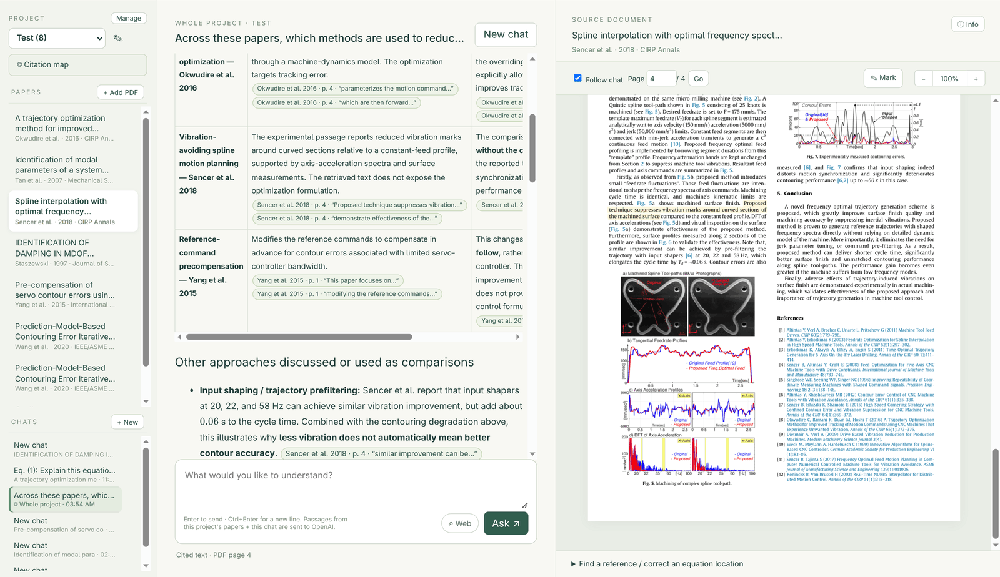

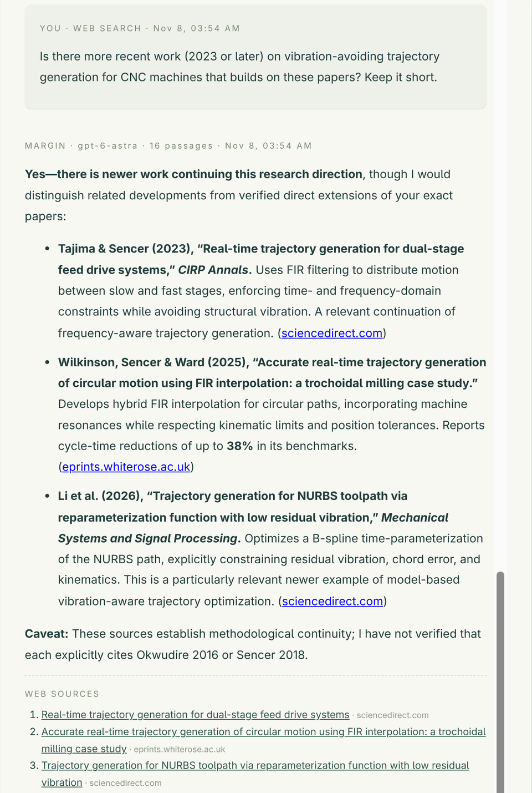

### Getting PDFs

**+ Add PDF** (or drag a PDF onto the window) adds a file you already have. For papers found through references or the map, **Add to project** tries, in order:

1. **An open-access copy** (from OpenAlex), downloaded directly.
2. **The Margin connector extension**, if paired (see below): the paper opens in your normal browser.
3. **A sign-in window** (desktop app): the publisher page opens inside Margin, through your library proxy if you set one; the PDF is added as soon as it downloads there.
4. In a plain browser without either: the publisher page opens in a new tab; download the PDF and drag it onto Margin.

Paywalled papers still need your institution's access; Margin only uses the logins you already have.

#### Margin connector (browser extension)

The extension in the `extension/` folder lets **Add to project** use your everyday browser, where you're already signed in to your library and publishers.

- **What it does:** Margin opens the paper's page in your browser; the extension finds the PDF on that page and sends it back to Margin. Publishers that refuse background downloads (e.g. ScienceDirect) are handled by following the page's own **View PDF** link and handing the browser's own download to Margin; if needed, a banner asks you to click **View PDF**.
- **Manual send:** on any paper page, click the Margin icon → **Send this page's PDF to Margin** (it goes to the project you last opened).
- **Works in** Chrome, Edge and Brave.

**Install:**

1. Open `chrome://extensions` and turn on **Developer mode**.
2. Click **Load unpacked** and choose the folder shown in Margin's **Settings → Browser extension**:
   - installed app: `~/.config/Margin/extension` (Linux), `%APPDATA%\Margin\extension` (Windows), `~/Library/Application Support/Margin/extension` (macOS);
   - from source: `./extension` in the repo.
3. Click the Margin icon in the browser toolbar and paste the pairing code from **Settings** (**Show code** copies it).

**Privacy:** the extension acts automatically only for papers Margin asked for (or when you click **Send**), reads only the page's DOI, title and PDF links, and talks only to Margin on `127.0.0.1`. It looks for Margin on port 47317 (desktop app) and 4317 (`npm run dev`).

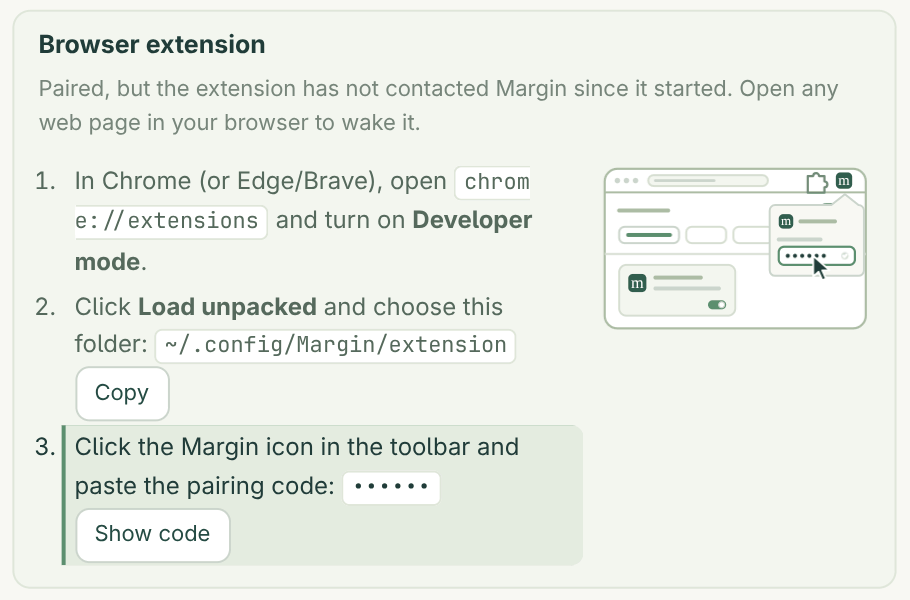

### Settings

- **AI provider** (OpenAI or Claude) and its **API key** (see [Set up your API key](#set-up-your-api-key)), with links to the provider's key, Usage and Billing pages.
- **Model**: pick from the list or type a model ID. The header menu changes it too.
- **Library proxy prefix** (optional), e.g. `https://proxy.lib.example.edu/login?url=` (EZproxy style). Used when opening publisher pages.
- **Browser extension**: folder and pairing code.
- **Theme**: System, Light or Dark.

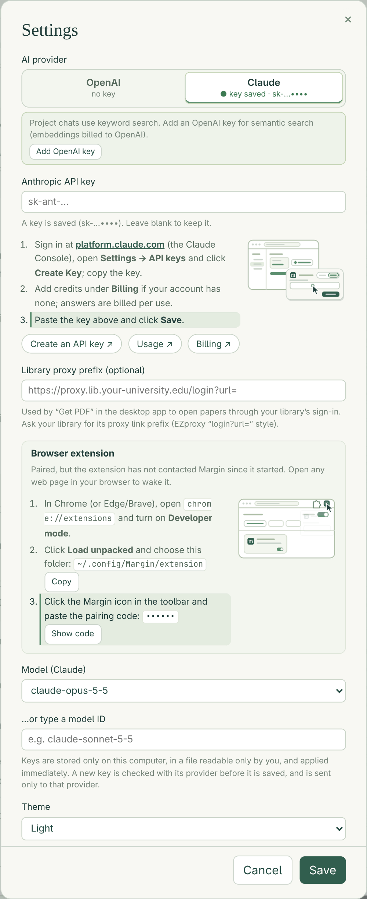

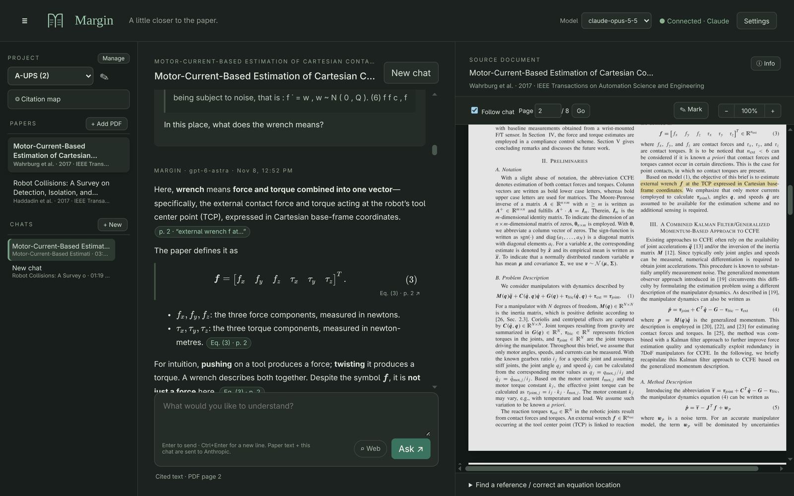

The demo GIF uses an original demo paper (`docs/demo/paper.html`).

## Run from source

Requires Node.js 22.12+ (Node 24 LTS recommended).

```bash
git clone https://github.com/QuokeCola/margin.git
cd margin
npm ci
npm run app          # desktop window (Electron); includes the publisher sign-in window
# or, in a browser:
npm run dev          # then open http://127.0.0.1:4317
```

In browser mode the key is saved to `.env` in the project folder (mode 600); `PORT` in `.env` changes the port (the extension only looks on 4317 and 47317). Hand edits to `.env` need a server restart. `npm run build && npm start` serves the built version.

The packaged app ships only the `en-US` and `en-GB` Chromium locales (`electronLanguages` in `package.json`) and only pdf.js's `legacy/build` files the server uses (the page's pdf.js is bundled into `dist/` by Vite). Build installers with `npm run dist:linux`, `npm run dist:win` (works on Linux with Wine) or `npm run dist:mac` (macOS only). Pushing a tag such as `v2.1.0` runs `.github/workflows/release.yml`, which runs the tests, builds all four on Linux, Windows and macOS runners and publishes a GitHub Release (**Run workflow** builds without releasing).

## Study workflow in detail

1. **Projects.** The sidebar starts with a project switcher (✎ renames, × deletes, “+ New project…” in the list). Paper details are looked up from the DOI or title on the PDF's first page; only the DOI or title is sent. A library from version 1.x is copied into a project called “My papers” on first start (the old files are left in place).
2. **Papers and chats.** **+ Add PDF** stores a copy in the library, so it reopens from the sidebar; adding the same file again (or a PDF whose DOI is already in the project) opens the existing entry. **New chat** starts a chat about **This paper** or the **Whole project**; click a chat to switch, double-click a paper or chat to rename it, × deletes. Chats are saved after every answer, with the model and time of each reply. ☰ hides the library.
3. **Ask.** Enter sends; Ctrl+Enter (or Shift+Enter) adds a line break. Press Enter with an empty box after attaching a passage or equation to have it explained. The model has no memory beyond the current chat's last 28 messages; other chats are not shared.
4. **Citations.** Anchored chips highlight the 5–15 words the model copied from the paper (matching tolerates spacing, hyphenation and small differences, and falls back to the closest match or the cited page). Plain mentions such as “Eq. (61)” or “p. 4” are also clickable (dotted underline). Chips are repeated at the bottom of each answer. With **Follow chat** off, you can explore the PDF independently; explicit clicks still work.
5. **Equation frames** cover the equation number plus the neighbouring lines that look like math, within the column. Extracted text drops overbars, hats and other accents, so equations and selections are sent as images too.
6. **References.** Bibliographies numbered “[1]” or “1.” are supported; author–year and superscript styles are not linked yet.
7. **Citation map.** Arrows point to the cited paper and size follows citation count; 15 citing works per paper. Drag to move, scroll to zoom; **↻** fetches the links again (they are cached for a week).
8. **Correct an equation location.** In **Find a reference / correct an equation location**, enter an equation number and click **Find equation**. To correct it, enter the PDF page and position from the top, or click the page with this panel open, then **Save correction**. **Remove correction** returns to automatic detection.

Page numbers always mean 1-based PDF positions, not printed journal page numbers. Example: `[[eq:61|p:11]]` or `[[p:11]]`. The parser also recognizes `Eq. (61)`, `Equation 61 on page 11`, `Eqs. 57–58`, and `p. 11`. Model citations and detected labels must be checked against the original.

## Privacy and security

**What is sent to the AI provider you selected** (OpenAI or Anthropic, through the local server; for OpenAI with `store: false`; this is not a claim of zero retention by either provider):

- **This paper chats:** the extracted text of the entire paper, up to 28 recent chat messages, your question and any attached image. Full-paper context avoids missing distant references but costs more than retrieval and can exceed a smaller model's context window.
- **Whole project chats:** each paper's title, authors, venue, year and abstract (or the start of its first page), the most relevant passages for the question (up to 16, at most 8 per paper), recent messages and your question. To build the search index, each paper's text is sent once to OpenAI's embeddings API (only when an OpenAI key is saved, also when Claude answers) (`text-embedding-3-small`); the index is cached next to the PDF. If embeddings fail, Margin ranks passages by keywords instead.
- **Web** (when on): the model may run web searches; the pages it used are listed under the answer.

API usage is billed to your account per request (and per web search).

**Other services:** paper details, references and citing works come from OpenAlex (Crossref as fallback); only DOIs, titles and work ids are sent. Open-access PDFs are downloaded from their public URLs.

**Local server:**

- Binds only to `127.0.0.1`, validates Host and Origin, and requires a random per-launch session token for every API call except status. No CORS access is enabled, apart from the paired browser extension's own endpoints, which need its pairing code. It is a local tool, not a multi-user hosting service; do not expose it through a tunnel.
- Your API key stays in the server environment / ignored `.env` (desktop app: `settings.env` in the app's config folder). It is never returned by the status endpoint, stored in the browser, or bundled into client JavaScript. Do not commit or share `.env`.
- Markdown is sanitized before display. External answer images are removed. There is no analytics or application request-body logging.

**Where data lives:** papers (`papers/<sha256>/`: PDF, details, search index, equation corrections) and projects with their chats (`projects/<id>/`) are stored under `~/.local/share/margin/` (Linux, both browser and desktop app) or in `library` inside the desktop app's config folder on Windows and macOS. `MARGIN_DATA_DIR` overrides the location. Corrections saved by the older version in browser storage are moved into the library the first time that PDF is opened. Delete a paper in the library to remove its PDF copy and chats. The theme choice is kept in the app's browser storage.

## Limits and troubleshooting

Text extraction is not OCR. Scans need OCR before use. Mathematical symbols, split equation labels, multi-column text, and journal layouts may extract poorly. Equation detection accepts “(12)”-style numbers (including section-style numbers such as “(3.2)” or “(A.1)”) that end their line, at a column edge or set off by a tab-like gap, including numbers split into pieces or written with broken-font parentheses; numbers in running text (“Eq. (3)”) and function arguments (“x(1)”) are ignored. Frames are built from text positions; equations spanning both columns of a two-column page are framed in one column only. `node scripts/eq-eval.mjs [--detail] paper.pdf …` reports detected numbers, gaps, duplicates and implausible frames for a set of PDFs. Manual corrections are authoritative.

Supported limits: 60 MB PDF, 300 pages, 600,000 extracted characters total, 30,000 characters per page. The model's own context limit can be lower. Large PDFs and high zoom levels can consume substantial browser memory. The API request has a 120-second timeout and one SDK retry. Quota, authentication, inaccessible-model and general request failures appear below the question box; the question is restored for retry. If a Web answer fails, the model may not support web search: turn **Web** off or pick another model.

If the key is missing, the reader and manual navigation still work. Add the key in Settings to enable answers. This app does not silently substitute another model or generate fake answers.

**Extension not connecting?** Make sure Margin is running, then open the extension popup: it says whether it found Margin and whether it is paired. The desktop app uses port 47317 when it is free; if another program holds it, the app picks a different port and the extension cannot find it. If a PDF never arrives, open it on the paper's page and use **Send this page's PDF to Margin**.

## Validation and code map

```bash
npm test
npm run build
```

- `electron/main.mjs`: desktop shell; starts the server in an Electron utility process (port 47317 when free), the publisher sign-in window, and copies the extension to the app's settings folder.
- `electron/preload.cjs`: the one desktop bridge the page may use (sign-in window, opening links in your browser).
- `server.mjs`: loopback server, settings (`.env`), model list, library and chat API, extension endpoints, provider settings and model lists; `lib/llm.mjs`: OpenAI Responses and Anthropic Messages requests (with optional web search).
- `lib/store.mjs`: projects, shared paper store, chats (with a per-project `chats-index.json` summary cache), and the 1.x migration.
- `lib/project-index.mjs`, `lib/pdf-text.mjs`, `lib/extract-worker.mjs`: project-chat search index (embeddings cached per paper); PDF text is extracted by pdf.js in worker threads.
- `lib/retrieval.mjs`: passage splitting, embedding and keyword (BM25) ranking, and the project-chat context.
- `lib/labels.mjs`: short paper ids and author–year labels used in project-chat citations.
- `lib/metadata.mjs`: OpenAlex/Crossref lookup and DOI/title helpers.
- `lib/config.mjs`: `.env` updating, model filter, validation helpers.
- `src/main.js`: PDF extraction/rendering, chat, citations, synchronization, manual corrections, settings.
- `src/layout.js`: equation-number filter, equation frames and quote matching from pdf.js text-item geometry.
- `src/quote.js`: faster quote matching used for citation highlights (same results as `layout.js`).
- `src/references.js`: citation token parsing and resolution.
- `src/bib.js`: numbered bibliographies, in-text citation markers, matching entries to OpenAlex records.
- `src/map.js`: the citation map (d3-force layout in SVG, filters, timeline, expand).
- `src/theme.js`, `src/zoom.js`: System/Light/Dark theme; zoom limits and pinch/scroll step size.
- `extension/`: the Margin connector (Manifest V3): `content.js` finds the DOI, title and PDF links on a page, `background.js` matches pages to Margin's requests and delivers PDFs, `popup.*` handles pairing and manual send.
- `scripts/eq-eval.mjs`, `scripts/eq-bench.mjs`: equation-detection report and benchmark used to tune `src/layout.js`.
- `scripts/ext-sites.mjs`: publisher test for the extension's PDF finding (development tool).
- `test/`: unit tests for layout, quotes, references, bibliographies, retrieval, the search index, store and chat index, config, theme and zoom.

API implementation follows the official documentation: https://developers.openai.com/api/docs/guides/text
